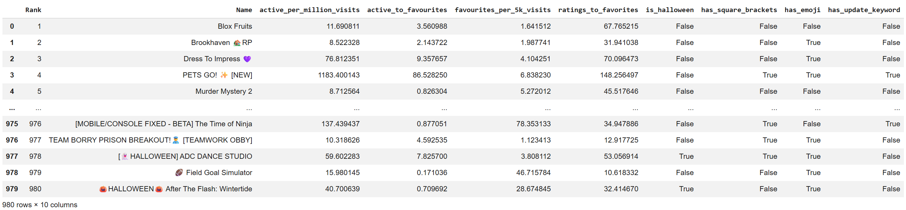
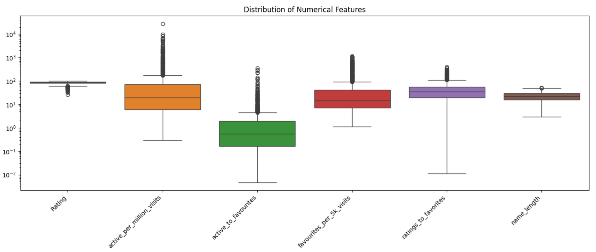
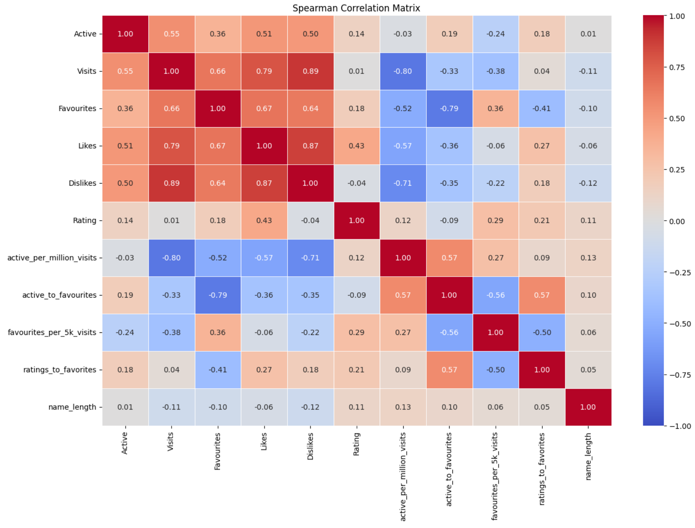
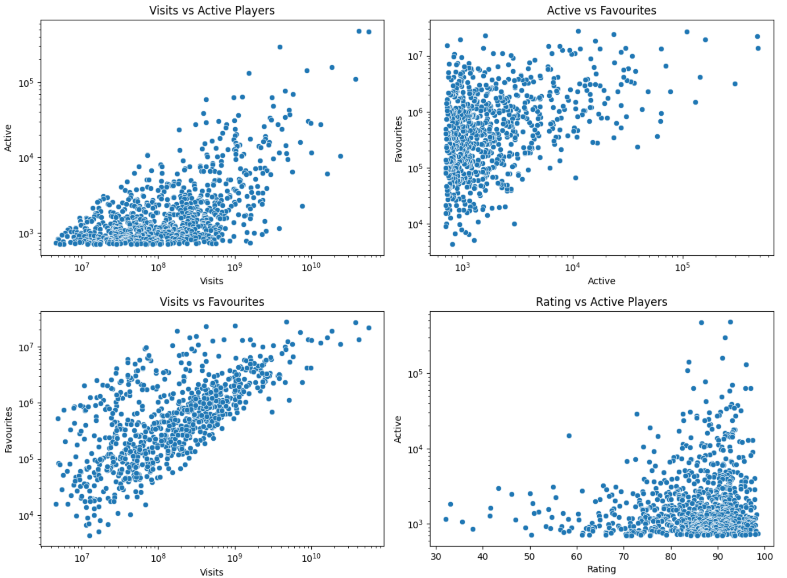
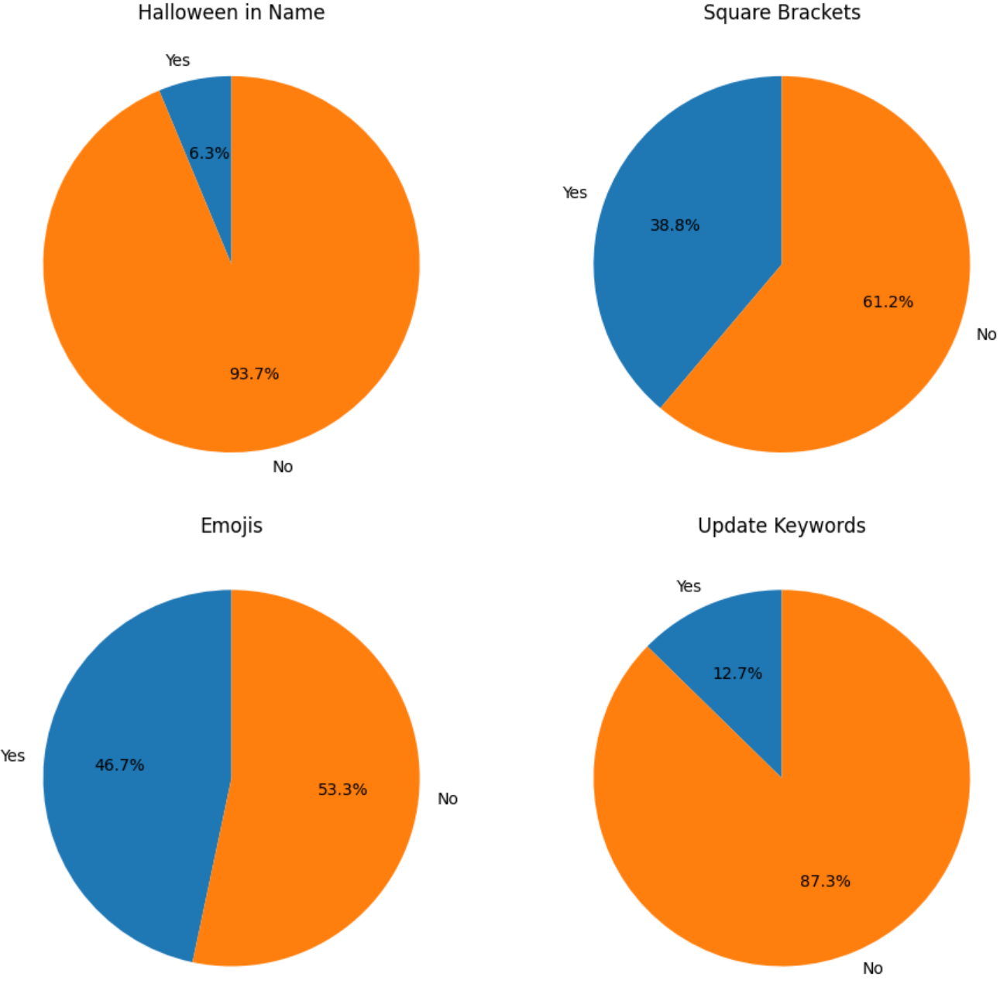
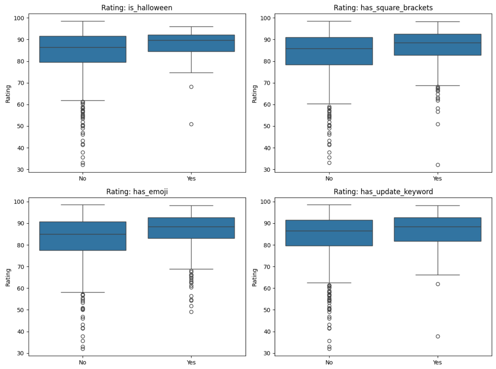
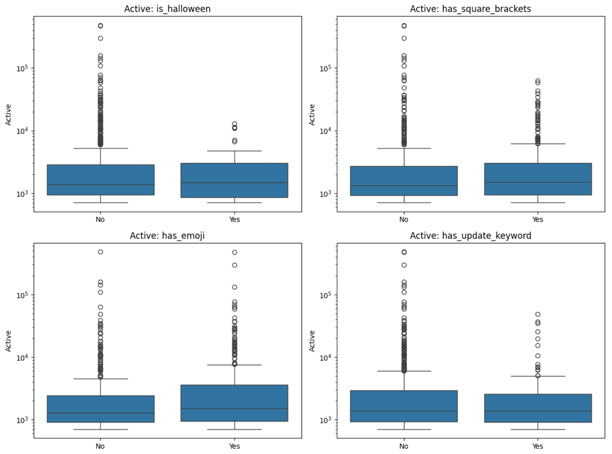

# Roblox Popular Games – Exploratory Data Analysis

An exploratory data analysis of the 1,000 most popular Roblox games, examining the relationships between player activity, cumulative engagement metrics and game naming conventions.

## Project Overview

The aim of this project was to investigate what can be learned about popular Roblox games from publicly available engagement metrics.

The analysis focuses on three areas:

- **Popularity and exposure:** How do current player counts relate to cumulative visits?
- **Player engagement:** How do visits, favourites and ratings relate to one another?
- **Naming conventions:** Do features such as emojis, square brackets, update keywords or Halloween references correspond to differences in player activity or ratings?

The project was completed using Python and Jupyter Notebook, with Pandas for data manipulation and Seaborn/Matplotlib for visualisation.

## Tools and Technologies

- Python
- Pandas – data cleaning and feature engineering
- Matplotlib – data visualisation
- Seaborn – statistical plots and correlation analysis
- Jupyter Notebook – analysis environment

## Dataset

**Source:** [Roblox Games Dataset – Kaggle](https://www.kaggle.com/datasets/biggiefats/roblox-games-dataset)

The dataset contains the top 1,000 Roblox games, ranked by their active player counts. It includes the following metrics:

| Column | Description |
|---|---|
| Rank | Position on the active player leaderboard |
| Name | Game title |
| Active | Current number of active players |
| Visits | Cumulative visits |
| Favourites | Cumulative favourites |
| Likes | Total likes |
| Dislikes | Total dislikes |
| Rating | Percentage of positive ratings |

The dataset represents a snapshot taken in October 2024, rather than a historical record of player activity.

## Data Preparation and Feature Engineering

### Cleaning

The initial dataset contained duplicate records and numerical columns stored as strings with thousands separators.

The preparation process involved:

- Converting numerical columns into appropriate integer types.
- Recalculating game ratings using likes and dislikes.
- Identifying duplicate game names and inspecting them to distinguish duplicate records from separate games with the same name.
- Removing exact duplicate rows.
- Resetting the leaderboard ranks after duplicate removal.

This reduced the dataset from 1,000 to **980 unique records**.

### Feature Engineering

Additional variables were created to explore relationships that were not immediately visible from the original dataset.

**Engagement ratios**

| Feature | Calculation | Purpose |
|---|---|---|
| 'active_per_million_visits' | Active / Visits × 1,000,000 | Current activity relative to cumulative traffic |
| 'active_to_favourites' | Active / Favourites × 100 | Current activity relative to accumulated favourites |
| 'favourites_per_5k_visits' | Favourites / Visits × 5,000 | Favourites relative to cumulative visits |
| 'ratings_to_favorites' | (Likes + Dislikes) / Favourites × 100 | Rating volume relative to favourites |

These ratios are exploratory indicators, not direct measurements of retention or unique-player behaviour.

**Name-based features**

Game names were also analysed to identify common naming conventions:

- 'is_halloween' – whether the name contains the word Halloween.
- 'has_square_brackets' – whether the name contains square brackets.
- 'has_emoji' – whether the name contains an emoji.
- 'has_update_keyword' – whether the name contains UPDATE, NEW, BETA or UPD.
- 'name_length' – number of characters in the game name.

## Exploratory Data Analysis

### 1. Distribution of Numerical Features

Box plots were used to examine the distributions of the numerical variables and identify unusually large or small observations.

### 2. Outlier Identification

Outliers were identified using the Interquartile Range (IQR) method on 'active_per_million_visits'.

This identified 151 observations outside the calculated bounds, reducing the analysis dataset from 980 to **829 games**.

The filtered dataset was used for subsequent correlation and naming-feature comparisons. The original dataset was also retained to inspect how removing these observations affected the relationships between variables.

Importantly, these observations are statistical outliers in the engineered ratio; they are not necessarily erroneous records.

### 3. Correlation Analysis

Spearman rank correlation was used to investigate monotonic relationships between the numerical variables.

**Key observations**

- Visits were strongly correlated with likes (+0.79) and dislikes (+0.89).
- Visits had almost no correlation with rating (+0.01).
- Name length had negligible correlations with most numerical variables, including rating (+0.11).

This suggests that games with greater cumulative exposure tend to accumulate more positive and negative ratings, but exposure alone does not indicate better player reception.

Some correlations involving engineered ratios are affected by shared mathematical components, such as a common numerator or denominator. These relationships should therefore be interpreted cautiously.

### 4. Relationships Between Visits, Active Players and Favourites

Scatter plots using logarithmic axes were used to investigate the relationships between cumulative visits, current active players and favourites.

**Key observations**

- Games with high cumulative visits can have relatively few active players.
- The relationship between visits and favourites is uneven: some games accumulate disproportionately high numbers of favourites relative to visits.
- Current active player counts and cumulative favourites also show an uneven relationship.

These observations highlight differences between current activity and accumulated engagement. However, the dataset does not provide enough historical information to establish why these differences occur.

### 5. Game Naming Conventions

The final part of the analysis investigated whether particular naming conventions were associated with differences in game ratings and active player counts.

Four features were examined:

- Halloween references
- Square brackets
- Emojis
- Update-related keywords

Pie charts were used to show how frequently each feature appeared in the filtered dataset.

Box-and-whisker plots were then used to compare the distributions of ratings and active player counts between games with and without each feature.

**Descriptive findings**

The group averages showed the following patterns:

| Naming feature | Mean rating: No | Mean rating: Yes | Mean active: No | Mean active: Yes |
|---|---:|---:|---:|---:|
| Halloween | 84.21 | 87.25 | 6,149 | 2,666 |
| Square brackets | 83.08 | 86.49 | 7,129 | 4,043 |
| Emojis | 82.51 | 86.56 | 5,210 | 6,753 |
| Update keywords | 84.15 | 86.12 | 6,266 | 3,618 |

Games with all four naming features had higher average ratings than games without the respective feature in this dataset.

The relationship with active player counts was less consistent: games with emojis had a higher average active player count, while the other three groups had lower averages.

These are descriptive comparisons, not evidence that the naming conventions themselves cause differences in ratings or popularity.

## Limitations

There are several limitations to consider when interpreting the results:

- **Snapshot data:** The dataset does not contain historical player counts, so trends in growth, decline or retention cannot be established.
- **Cumulative metrics:** Visits, favourites, likes and dislikes accumulate over time and do not represent unique players.
- **Outlier filtering:** Removing observations based on 'active_per_million_visits' changes the population being analysed and can affect observed relationships.
- **Confounding variables:** Genre, game age, update frequency and other factors may influence popularity and ratings.
- **Naming conventions:** The presence of a particular word or symbol does not establish why a game is popular or well-rated.

## Conclusion

This project explored the relationships between popularity, engagement metrics and naming conventions across a dataset of popular Roblox games.

The analysis found that cumulative visits were strongly associated with the number of likes and dislikes, but not with the overall rating. Name length showed little relationship with the other numerical variables.

Naming-feature comparisons also revealed differences in average ratings and active player counts, although these relationships cannot establish causation.

Overall, the project demonstrates a practical workflow for cleaning a real-world dataset, engineering additional features, visualising distributions and relationships, and interpreting exploratory findings while accounting for the limitations of the available data.

## Repository Structure

'''text
Roblox_Popular_Games_Analysis/
│
├── Roblox_Popular_Games_Analysis.ipynb
├── roblox_games.csv
├── README.md
│
└── images/
    ├── numerical_distributions.png
    ├── feature_engineering.png
    ├── correlation_heatmap.png
    ├── engagement_scatterplots.png
    ├── naming_feature_distribution.png
    ├── naming_feature_ratings.png
    └── naming_feature_active_players.png
'''

## Running the Project

1. Clone the repository.
2. Download the dataset from [Kaggle](https://www.kaggle.com/datasets/biggiefats/roblox-games-dataset).
3. Place 'roblox_games.csv' in the project root directory.
4. Install the required dependencies:

'''bash
pip install pandas matplotlib seaborn scipy jupyter
'''

5. Open the notebook:

'''bash
jupyter notebook Roblox_Popular_Games_Analysis.ipynb
'''
